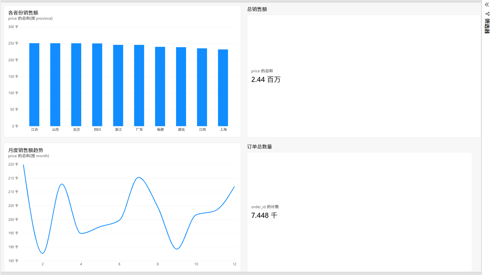

# 陶瓷电商平台用户销售数据分析

## 📌项目背景

本项目模拟景德镇陶瓷线上电商店铺的真实经营场景，生成模拟订单数据集，完成完整的数据分析流程。

从商品品类、地域分布、销售时间趋势、用户复购四个角度，挖掘店铺经营现状，为陶瓷电商运营提供可落地的业务优化建议。

> 说明：本项目无公开真实陶瓷行业数据集，全部订单数据由Python代码模拟生成，运行源码即可复现数据集，不上传原始csv文件。

## 🛠️工具与技术栈

- Python：`pandas`、`numpy`、`matplotlib`

- BI工具：PowerBI Desktop（制作可视化业务看板）

- 开发环境：PyCharm 2026.2.3

## 📄数据说明

一共模拟生成8000条原始订单记录

字段清单：

|字段|含义|

|----|----|

|order_id|订单编号|

|user_id|用户ID，一个用户可有多笔订单|

|order_time|下单时间|

|ceramic_category|陶瓷品类（茶具、餐具、花瓶、雕塑瓷、装饰摆件）|

|price|订单金额|

|province|收货省份|

|pay_status|支付状态，1=已支付，0=未支付|

### 数据清洗处理工作

1. 将下单时间转换为时间格式，拆分月份、星期字段，便于时间维度统计；

2. 过滤未支付订单，只保留有效成交数据；

3. 过滤价格为负数的异常脏数据；

4. 根据订单编号去除完全重复订单；

5. 清洗后得到有效成交订单用于后续分析。

## 📊分析核心维度与结论

### 1. 商品品类分析

统计各个品类的订单数量、总销售额、平均客单价：

- 茶具类订单量最高，属于店铺走量主力产品；

- 雕塑瓷订单数量不算高，但是平均客单价最高，属于高利润高端品类；

- 餐具、花瓶、装饰摆件销量处于中间梯队。

> 业务结论：店铺产品结构分层明显，茶具负责走销量，雕塑瓷负责拉高利润。

### 2. 地域销售分析

统计各省份订单量与销售总额：

- 省外：广东、浙江、江苏是主要消费市场，线上陶瓷消费需求旺盛；

- 江西本地也存在稳定的购买需求。

> 业务结论：店铺客户大部分来自省外，不能只局限本地流量，需要重点向外省做推广。

### 3. 月度销售趋势分析

统计全年每个月份订单变化情况：

- 临近春节的月份订单出现上涨，礼品属性陶瓷销量提升；

- 其余月份订单保持平稳，淡旺季区分明显。

> 业务结论：节日礼品效应明显，大促、节假日是销售窗口期，需要提前备货。

### 4. 用户复购分析

统计付费用户下单次数，计算复购率：

- 大部分用户仅下单一次，复购用户占比偏低；

- 用户一次性消费占比高，老客留存不足。

> 业务结论：店铺拉新效果尚可，但是老客户维护能力不足，缺少用户留存运营手段。

## 💡业务运营优化建议

1. **产品策略**

茶具作为走量爆款，可以组合套餐做活动引流；雕塑瓷客单价高，重点打造高端产品宣传，提升溢价。

2. **投放策略**

加大广东、浙江、江苏等省外市场线上投放，挖掘省外客户；兼顾江西本地流量。

3. **时间运营**

春节、中秋等节日前提前备货，上线节日礼品陶瓷套装，抓住礼品消费高峰。

4. **用户运营**

增加会员、优惠券等老客激励手段，提高老用户复购，改善当前复购率偏低现状。

## 📂项目文件说明

